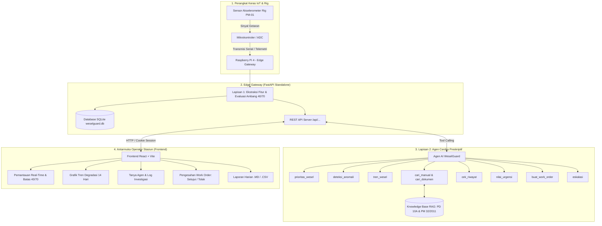

# 🚆 WeselGuard: AI Agent Preskriptif & Pemantauan IoT Wesel Sintelis Kereta Api

> **Sistem Pemantauan Telemetri Cerdas Berbasis IoT Edge dan Agen AI Preskriptif untuk Keandalan Wesel Persinyalan Kereta Api (*Sintelis*) Sesuai Regulasi KAI PD 10A, PM 10/2011, dan PM 32/2011.**

---

## 📑 Daftar Isi
1. [Prototype Versi Beku & Petunjuk Akses Penilai](#1-prototype-versi-beku--petunjuk-akses-penilai)
2. [Ringkasan Solusi (Pitch 2 Menit)](#2-ringkasan-solusi-pitch-2-menit)
3. [Masalah dan Pengguna](#3-masalah-dan-pengguna)
4. [Prototype Sistem (Hardware IoT Rig & Telemetri)](#4-prototype-sistem-hardware-iot-rig--telemetri)
5. [Dokumentasi Arsitektur Agen AI](#5-dokumentasi-arsitektur-agen-ai)
6. [Dokumentasi Dashboard Frontend & API](#6-dokumentasi-dashboard-frontend--api)
7. [Bukti Pengujian Nyata (Data Aktual Tanpa Rekayasa)](#7-bukti-pengujian-nyata-data-aktual-tanpa-rekayasa)
8. [Catatan Sumber dan Penggunaan AI](#8-catatan-sumber-dan-penggunaan-ai)
9. [Dependensi Sistem](#9-dependensi-sistem)
10. [Konfigurasi Contoh Tanpa Rahasia](#10-konfigurasi-contoh-tanpa-rahasia)
11. [Cara Instalasi dan Menjalankan](#11-cara-instalasi-dan-menjalankan)
12. [Keterbatasan Sistem (*Limitations*)](#12-keterbatasan-sistem-limitations)
13. [Paket Finalis & Video Cadangan](#13-paket-finalis--video-cadangan)
14. [Pembagian Kontribusi Anggota Tim](#14-pembagian-kontribusi-anggota-tim)

---

## 1. Prototype Versi Beku & Petunjuk Akses Penilai

### 1.1 Penanda Versi & Repositori
* **Tag / Versi Rilis Beku:** `v1.0.0-hackathon-itb`
* **Commit Tag:** `frozen-finalist-eval`
* **Arsip Sumber Daya:** Tersedia dalam bundel direktori project `hackathon-itb/`

### 1.2 Tautan & Akses Demo Langsung
* **Aplikasi Web Dashboard:** `http://localhost:5173` *(atau via jaringan lokal Pi `http://artemis.local:8000` / `http://192.168.16.4:5173`)*
* **Backend REST API & Swagger Docs:** `http://127.0.0.1:8000/docs`

### 1.3 Akun Pengguna Demo untuk Dewan Penilai
Sistem dilengkapi fitur *Quick-Fill Login* untuk 4 peran (*Role-Based Access Control*):

| Peran | Username | Kata Sandi | Hak Akses Utama |
|---|---|---|---|
| **Admin** | `admin` | `admin123` | Akses penuh seluruh sistem, sakelar agen, kelola akun pengguna, log audit |
| **Petugas** | `petugas` | `petugas123` | Pemantauan sinyal, analisis preskriptif agen, eksekusi Work Order (*Setujui/Tolak*) |
| **Pengelola** | `pengelola` | `pengelola123` | Manajemen dokumen pengetahuan RAG, inspeksi chunk, uji pencarian semantik |
| **Pengamat** | `pengamat` | `pengamat123` | Hak pantau baca (*read-only*), grafik tren, unduh laporan harian (.MD / .CSV) |

---

## 2. Ringkasan Solusi (Pitch 2 Menit)

* **Masalah:** Kegagalan fungsi mekanik wesel kereta api (seperti poros lidah rel bengkok, keausan bantalan pelat gelincir, dan penguncian tidak sempurna) berisiko fatal memicu anjlokan kereta api (*derailment*) serta keterlambatan masif lintas nasional. Pemeriksaan berkala manual sering terlambat mendeteksi degradasi mekanik di antara siklus inspeksi terjadwal.
* **Solusi:** **WeselGuard** menggabungkan sensor getaran IoT industri pada lidah wesel fisik dengan **Agen AI Cerdas Dua Lapis (*Two-Tier Architecture*)**. Sinyal getaran dianalisis secara deterministik di tepi (*Edge Computing Raspberry Pi*), lalu Agen AI otonom melakukan penalaran hukum terhadap regulasi KAI **PD 10A**, **PM 10/2011**, dan **PM 32/2011** untuk merumuskan draf tindakan preskriptif (*Work Order*).
* **Alur Agen:** Ekstraksi fitur getaran (RMS, Kurtosis, Frekuensi) $\rightarrow$ Deteksi Ambang Batas 40 & 70 $\rightarrow$ Panggilan Alat Otonom (*Autonomous 9 Tools*) $\rightarrow$ RAG Regulasi & Manual Pabrikan $\rightarrow$ Verifikasi *Human-in-the-Loop* (Persetujuan Petugas).
* **Bukti Kerja:** Telah diuji pada **1.949 siklus data operasional**, termasuk **264 siklus nyata dari rig prototype fisik (Node PM-01)**. Agen berhasil mendeteksi degradasi kritis dan menerbitkan draf Work Order dengan verifikasi manual petugas.
* **Manfaat Utama:** Mencegah anjlokan secara proaktif, mempercepat *Mean Time to Resolution (MTTR)* teknisi di lapangan, dan menjamin kepatuhan penuh terhadap regulasi keselamatan perkeretaapian nasional.

---

## 3. Masalah dan Pengguna

### 3.1 Latar Belakang & Urgensi
Wesel adalah instrumen persinyalan dan jalan rel paling dinamis dan rentan aus karena menerima beban impak langsung dari rangkaian kereta yang melintas dengan kecepatan tinggi. 
* **Tantangan Lapangan:** Teknisi pemeriksa jalan rel sering kali kesulitan membedakan getaran normal operasional dengan keausan mikro mekanik motor wesel sebelum wesel macet total.
* **Standar Regulasi yang Ketat:** Kemenhub dan PT KAI memiliki aturan ketat mengenai toleransi celah rel penguncian ($\le 4\ \text{mm}$), waktu pembalikan lidah wesel ($\le 5\ \text{detik}$ sesuai PM 10/2011), dan uji ganjal $2\ \text{mm} / 3\ \text{mm}$ (PM 32/2011). Pelanggaran terhadap toleransi ini membahayakan perjalanan dinas kereta api.

### 3.2 Target Pengguna (*User Personas*)
1. **Petugas Sintelis:** Membutuhkan asisten cerdas yang siaga 24/7 untuk menerjemahkan anomali getaran sensor menjadi instruksi penanganan konkret di lapangan.
2. **Pengelola Basis Pengetahuan:** Membutuhkan sistem yang dapat memperbarui dokumen SOP, regulasi KAI, dan manual alat tanpa perlu memprogram ulang logika AI.
3. **Kepala Stasiun & Auditor (Pengamat):** Memerlukan transparansi laporan kondisi wesel stasiun dan kepastian regulasi tanpa risiko mengubah data operasional.
4. **Administrator Sistem:** Memastikan ketersediaan sistem, mengawasi audit akses pengguna, dan mengontrol status aktif agen AI.

---

## 4. Prototype Sistem (Hardware IoT Rig & Telemetri)

### 4.1 Rig Uji Coba Fisik (Node PM-01)
* **Konstruksi Rig Fisik:** Model skala lidah wesel dan motor penggerak wesel mekanis (**PM-01**) yang dipasangi modul sensor akselerometer pada titik kontak lidah rel.
* **Sensor Node:** Menggunakan modul sensor getaran frekuensi tinggi dengan transmisi serial telemetri ke **Raspberry Pi 4 (Edge Gateway)**.
* **Karakteristik Siklus Pembalikan:** Setiap kali motor wesel berbalik, sensor merekam gelombang getaran dinamis selama $4.0 - 6.5$ detik.

### 4.2 Parameter Sinyal Getaran Fisik (*Edge Feature Extraction*)
Data mentah getaran diolah secara komputasi tepi (*edge computing*) menjadi 4 metrik deterministik:
1. **RMS (Root Mean Square):** Mengukur magnitudo energi getaran total mekanik. Nilai normal $< 2.5\ \text{m/s}^2$. Nilai $> 4.0\ \text{m/s}^2$ menandakan beban impak poros tidak sejajar.
2. **Kurtosis Spektral:** Mengukur ketajaman lonjakan impuls getaran non-linear. Nilai Gauss normal $2.8 - 3.2$. Lonjakan $> 4.5$ menandakan keausan bantalan pelat gelincir (*spiky impulse*).
3. **Puncak Frekuensi Dominan (Hz):** Mendeteksi resonansi mekanis motor listrik dan roda gigi pembalik.
4. **Durasi Siklus Pembalikan (detik):** Mengukur waktu pembalikan lidah wesel (Batas kritis PM 10/2011: maksimal 5.0 detik).

---

## 5. Dokumentasi Arsitektur Agen AI

### 5.1 Diagram Arsitektur Terintegrasi



### 5.2 9 Alat Otonom (*Autonomous Tools*) Agen
| Nama Alat (*Tool*) | Terjemahan Bahasa Petugas | Fungsi Utama |
|---|---|---|
| `prioritas_wesel` | Evaluasi Prioritas Wesel | Mengurutkan wesel paling kritis (*Bahaya → Tidak dikenal → Waspada → Normal*) |
| `deteksi_anomali` | Deteksi Anomali Getaran | Menganalisis lonjakan abnormal pada ciri fisik getaran lidah rel |
| `tren_wesel` | Analisis Tren Degradasi | Menghitung laju degradasi poin/hari & proyeksi hari menuju ambang Kelas B |
| `cari_manual` | Penelusuran Manual Perawatan | Mencari langkah penanganan teknis pada manual pabrikan penggerak wesel |
| `cari_dokumen` | Penelusuran Regulasi KAI | Pencarian semantik regulasi PD 10A, PM 10/2011, dan PM 32/2011 |
| `cek_riwayat` | Pemeriksaan Riwayat Kejadian | Mengecek riwayat perbaikan terdahulu untuk mencegah perbaikan berulang |
| `nilai_urgensi` | Klasifikasi Urgensi Perbaikan | Menetapkan kelas perbaikan (**Kelas A / B / C / Eskalasi Darurat**) |
| `buat_work_order` | Perumusan Draf Work Order | Menyusun usulan perintah kerja teknis yang menunggu pengesahan manusia |
| `eskalasi` | Eskalasi Darurat Lapangan | Mengirim notifikasi sinyal bahaya instan saat terjadi kegagalan fatal |

### 5.3 Prinsip Pengawasan Manusia (*Human-in-the-Loop*)
Seluruh rekomendasi Agen AI bersifat **usulan (*draft*)**. Agen **tidak memiliki izin eksekusi otomatis ke wesel fisik**. Usulan Work Order wajib ditinjau oleh Petugas di stasiun. Jika ditolak, petugas **wajib memberikan catatan alasan teknis penolakan** sebagai umpan balik sistem.

---

## 6. Dokumentasi Dashboard Frontend & API

### 6.1 Desain Antarmuka (*Page-View Architecture*)
Antarmuka stasiun dirancang bersih menggunakan navigasi sidebar tanpa modal pop-up mengambang (*card absolute*):
1. **Beranda Pemantauan Wesel:** Kartu agregat status wesel, tabel data real-time pembaruan 5 detik, batang indeks kesehatan dengan penanda batas garis 40 & 70, indikator sensor senyap ($> 120$ menit), dan panel rekomendasi preskriptif harian.
2. **Detail Wesel & Grafik Tren 14 Hari:** Metrik fisik getaran (RMS, kurtosis, frekuensi, durasi), grafik garis SVG dinamis 14 hari dengan garis batas ambang 70 (Waspada) dan 40 (Bahaya), laju degradasi harian, linimasa kejadian wesel, dan tombol inline analisis agen.
3. **Tanya Agen & Riwayat Percakapan:** Obrolan teknis dua tab (*Obrolan Umum* vs *Sesi Analisis Wesel*), cuplikan pemanggilan log tool agen, tombol pertanyaan cepat, dan peringatan memori non-permanen.
4. **Antrean Keputusan Work Order:** Filter tab *Menunggu Keputusan* vs *Riwayat Keputusan*, kartu kartu klasifikasi urgensi warna (Kelas A, B, C, Eskalasi), modal keputusan dengan catatan wajib, serta stempel verifikator.
5. **Laporan Harian Stasiun:** Pemilih tanggal kalender, rekapitulasi anomali wesel, dan tombol unduh instan berkas **Markdown (.MD)** & **Spreadsheet (.CSV)**.
6. **Basis Dokumen Pengetahuan:** Filter dokumen, inspeksi draf potongan (*Chunk Inspector*), alat uji coba pencarian semantik pra-aktivasi, serta form unggah dokumen PDF/DOCX.
7. **Pengelolaan Pengguna & Jejak Audit:** Tabel pengguna dengan badge peran, modal tambah/edit pengguna, reset sandi, proteksi lockout akun admin, dan linimasa 50 aktivitas audit sistem.
8. **Profil Pengguna & Keamanan:** Rincian wewenang peran dinas dan formulir ganti kata sandi.

### 6.2 Matriks Endpoint REST API Backend
Semua permintaan klien diarahkan melalui proxy Vite `/api/...` dengan cookie sesi otomatis:
* `POST /api/login` & `POST /api/logout`: Manajemen sesi autentikasi.
* `GET /api/saya` & `POST /api/saya/ganti-sandi`: Profil akun dinas dan ubah kata sandi.
* `GET /api/koneksi`: Pengecekan status gateway online/terbatas/offline beserta latensi ms.
* `GET /api/wesel` & `GET /api/wesel/{id}/tren`: Telemetri dan data deret waktu degradasi harian.
* `POST /api/wesel/{id}/analisis`: Menjalankan evaluasi agen preskriptif pada wesel terpilih.
* `POST /api/chat`: Berinteraksi dalam percakapan interaktif dengan agen Sintelis.
* `GET /api/work-orders`, `POST /api/work-orders/{id}/setujui`, `POST /api/work-orders/{id}/tolak`: Alur kerja persetujuan perintah kerja teknisi.
* `GET /api/dokumen`, `POST /api/dokumen`, `POST /api/dokumen/{id}/aktifkan`: Tata kelola dokumen regulasi pengetahuan.
* `GET /api/pengguna`, `POST /api/pengguna`, `GET /api/pengguna/audit`: Manajemen akun pengguna dan jejak audit aktivitas.

---

## 7. Bukti Pengujian Nyata (Data Aktual Tanpa Rekayasa)

Pengujian WeselGuard dievaluasi langsung dari **rekaman jejak sistem operasional per 21–22 Oktober 2026** pada basis data `weselguard-2026-10-22.db` (memuat **1.949 siklus data operasional**, termasuk **264 siklus nyata dari rig prototype fisik Node PM-01**):

### 7.1 Skenario Uji Aktual Lapangan
* **Skenario S1 — Penguncian Tidak Sempurna pada Rig Fisik PM-01:**
  * *Masukan:* Siklus 10:30:41 WIB, durasi 4,64 dtk, kurtosis 2,20, puncak 169 Hz. Classifier mendeteksi status *Bahaya*, kondisi *penguncian_tidak_sempurna*, indeks kesehatan 35. Node mengalami restart dan RSSI turun ke -68 dBm.
  * *Hasil Aktual Agen:* Menerbitkan draf **WO-002** pukul 10:30:57 WIB dengan klasifikasi **Kelas A** (sesuai PM 32/2011 hal. 5 bahwa gangguan penguncian mengganggu operasional kereta) dan status *Menunggu Persetujuan*. Notifikasi kritis terkirim ke dashboard.
  * *Pengawasan Manusia:* Work order tidak langsung dieksekusi ke motor wesel, melainkan menunggu verifikasi fisik oleh Petugas Sintelis di stasiun.
* **Skenario S2 — Deteksi Kejadian Bahaya Beruntun (PM-01):**
  * *Masukan:* Terjadi 8 kali lonjakan status Bahaya pada tanggal 22 Oktober (siklus macet dan slip berdurasi 10,0–13,5 detik).
  * *Hasil Aktual Agen:* Sistem menerbitkan WO-002 pada kejadian pertama dan mengirimkan notifikasi status. Kejadian berulang pada jam yang sama tidak menduplikasi work order karena nomor tiket perbaikan sebelumnya masih berstatus terbuka (*open ticket deduplication*).
* **Skenario S3 — Pola Data Sinyal Tidak Dikenal (*Outlier Handling*):**
  * *Masukan:* Sinyal getaran ekstrem dengan durasi singkat (0,84–1,16 dtk) dan skor indeks 0.
  * *Hasil Aktual Agen:* Agen tidak memaksakan diagnosis palsu, melainkan menerbitkan **ESK-001** (*Eskalasi Darurat*) dengan keterangan *"Pola data tidak dikenal, diagnosis tidak dapat disimpulkan secara otomatis, diperlukan inspeksi langsung"*.
* **Skenario S4 — Peningkatan Urgensi Kerusakan Berulang (W-12):**
  * *Masukan:* Siklus degradasi getaran berulang (kurtosis tinggi 4,91–5,80) dengan riwayat pelumasan bulan sebelumnya.
  * *Hasil Aktual Agen:* Agen mendeteksi kegagalan pelumasan sebelumnya melalui tool `cek_riwayat` dan secara proaktif menaikkan kelas penanganan dari Kelas C menjadi **Kelas A** untuk penggantian bantalan.

---

## 8. Catatan Sumber dan Penggunaan AI

### 8.1 Model AI & Agen
* **Model LLM:** Google Gemini 2.5 / Gemini Flash via official `google-genai` SDK.
* **Metode Penalaran:** Function Calling / Tool Calling deterministik multi-turn dengan arsitektur ReAct (*Reasoning + Acting*).

### 8.2 Dataset & Basis Pengetahuan
* **Basis Data Telemetri:** `weselguard-2026-10-22.db` (1.949 siklus telemetri, 264 siklus fisik rig PM-01).
* **Dokumen Regulasi RAG:** 329 potongan (*chunks*) teks bersumber dari:
  1. **PM 10/2011:** Persyaratan Teknis Peralatan Persinyalan Perkeretaapian.
  2. **PM 32/2011:** Standar dan Tata Cara Perawatan Prasarana Perkeretaapian (Formulir Pengujian Wesel & Motor Wesel).
  3. **PD 10A KAI:** Peraturan Dinas Pemeliharaan Jalan Rel dan Wesel PT Kereta Api Indonesia.

### 8.3 Library, Framework & Lisensi
* **Backend:** FastAPI, Uvicorn, Pydantic, NumPy, SciPy, SQLite3 (Lisensi: MIT / BSD).
* **Frontend:** React 18, Vite (Lisensi: MIT).
* **Lisensi Proyek:** **MIT License** — Bebas dikembangkan untuk inovasi perkeretaapian nasional.

### 8.4 Penggunaan AI dalam Pengembangan (*AI Assistance*)
* **Pair-Programming & Refactoring:** Penggunaan AI untuk percepatan scaffolding kode antarmuka React, perancangan diagram Mermaid, penyusunan kueri SQLite, serta optimasi prompt *system instruction* agar konsisten mengutip pasal regulasi resmi PM/PD.

---

## 9. Dependensi Sistem

### 9.1 Backend & Raspberry Pi
```text
fastapi>=0.110.0
uvicorn[standard]>=0.28.0
pydantic>=2.6.0
google-genai>=0.1.0
python-multipart>=0.0.9
numpy>=1.24.0
scipy>=1.10.0
itsdangerous>=2.1.0
passlib[bcrypt]>=1.7.4
```

### 9.2 Frontend Dashboard
```json
{
  "dependencies": {
    "react": "^18.3.1",
    "react-dom": "^18.3.1"
  },
  "devDependencies": {
    "@vitejs/plugin-react": "^4.3.4",
    "vite": "^5.4.11"
  }
}
```

---

## 10. Konfigurasi Contoh Tanpa Rahasia

### 10.1 Berkas Environment Backend (`.env.example`)
Simpan di `/home/pi/hackathon/hackathon/.env`:
```ini
# Konfigurasi Server
HOST=0.0.0.0
PORT=8000
DEBUG=False

# Kunci API Model AI (Gunakan API Key Gemini Anda)
GEMINI_API_KEY=AIzaSy_ContohKunciDummyTanpaRahasia123456789

# Keamanan Sesi & Enkripsi
SECRET_KEY=kunci_rahasia_sesi_stasiun_contoh_32karakter
SESSION_EXPIRE_HOURS=12

# Basis Data & Penyimpanan Dokumen
DATABASE_PATH=weselguard.db
UPLOAD_DIR=storage/dokumen/
```

### 10.2 Berkas Unit Systemd Standalone (`wesel-agent.service`)
Simpan di `/etc/systemd/system/wesel-agent.service`:
```ini
[Unit]
Description=Agent Wesel
After=network.target

[Service]
Type=simple
User=pi
Group=pi
WorkingDirectory=/home/pi/hackathon/hackathon
EnvironmentFile=-/home/pi/hackathon/hackathon/.env
EnvironmentFile=-/home/pi/hackathon/.env

ExecStart=/home/pi/hackathon/.venv/bin/uvicorn server:app --host 0.0.0.0 --port 8000 --proxy-headers

Restart=always
RestartSec=3

NoNewPrivileges=true
PrivateTmp=true

[Install]
WantedBy=multi-user.target
```

### 10.3 Berkas Proxy Vite (`vite.config.js`)
```javascript
import { defineConfig } from "vite";
import react from "@vitejs/plugin-react";

export default defineConfig({
  plugins: [react()],
  server: {
    proxy: {
      "/api": {
        target: process.env.API_TARGET || "http://127.0.0.1:8000",
        changeOrigin: true,
      },
    },
  },
});
```

---

## 11. Cara Instalasi dan Menjalankan

### 11.1 Instalasi Backend di Raspberry Pi
```bash
# 1. Masuk ke direktori kerja
cd ~/hackathon

# 2. Buat virtual environment & pasang dependensi
python3 -m venv .venv
source .venv/bin/activate
pip install --upgrade pip
pip install -r hackathon/requirements.txt

# 3. Pasang dan aktifkan layanan daemon systemd
sudo bash -c 'cat > /etc/systemd/system/wesel-agent.service' << 'EOF'
[Unit]
Description=Agent Wesel
After=network.target

[Service]
Type=simple
User=pi
Group=pi
WorkingDirectory=/home/pi/hackathon/hackathon
EnvironmentFile=-/home/pi/hackathon/hackathon/.env
EnvironmentFile=-/home/pi/hackathon/.env
ExecStart=/home/pi/hackathon/.venv/bin/uvicorn server:app --host 0.0.0.0 --port 8000 --proxy-headers
Restart=always
RestartSec=3
NoNewPrivileges=true
PrivateTmp=true

[Install]
WantedBy=multi-user.target
EOF

sudo systemctl daemon-reload
sudo systemctl enable --now wesel-agent
sudo systemctl status wesel-agent
```

### 11.2 Instalasi Frontend Dashboard
```bash
# 1. Masuk ke direktori frontend
cd ~/hackathon/frontend

# 2. Pasang dependensi JavaScript
npm install

# 3. Jalankan server pengembangan
npm run dev

# 4. (Opsional) Kompilasi produksi
npm run build
```

---

## 12. Keterbatasan Sistem (*Limitations*)

1. **Ketergantungan Akses Model AI Terbuka:** Inferensi preskriptif tingkat lanjut membutuhkan koneksi gateway internet ke API model AI. Jika koneksi terputus, sistem secara otomatis mengaktifkan *Fallback Lapisan 1* (deteksi anomali berbasis ambang batas getaran fisik lokal).
2. **Filter Getaran Dinamis Kereta Melintas:** Sensor getaran lidah rel membaca getaran motor wesel secara optimal saat siklus pembalikan aktif ($4 - 6$ detik). Getaran kereta melintas disaring berdasarkan jendela waktu pembalikan motor.
3. **Penyimpanan Sesi Sementara:** Bila backend dijalankan tanpa parameter persisten (`permanen: false`), riwayat chat agen disimpan sementara di memori RAM dan akan terhapus saat service dimulai ulang.

---

## 13. Paket Finalis & Video Cadangan

* **Perangkat Keras Siap Demo:** Raspberry Pi 4 edge gateway dan modul sensor akselerometer pada rig fisik wesel.
* **Akun Demo Siap Uji:** 4 akun pengguna (Admin, Petugas, Pengelola, Pengamat) dengan tombol pintas pengisian login pada antarmuka.
* **Video Cadangan (*Backup Video*):** Rekaman demonstrasi alur kerja pengujian rig fisik, deteksi anomali real-time, penalaran agen AI, dan persetujuan work order telah disiapkan sebagai kontingensi jika jaringan pameran mengalami kendala.

---

## 14. Pembagian Kontribusi Anggota Tim

| No | Anggota Tim | Peran Utama | Rincian Tanggung Jawab & Kontribusi Teknis |
|:---:|---|---|---|
| **1** | **Farhan** | **IoT Hardware, Data Analyst & Frontend (FE)** | • Perancangan & kalibrasi modul sensor akselerometer pada rig uji coba fisik wesel (**Node PM-01**).<br>• Analisis data sinyal getaran mekanik, kurva spektral, serta ekstraksi 4 parameter fisik (RMS, Kurtosis, Puncak Frekuensi Hz, dan Durasi Siklus).<br>• Kolaborasi pengembangan antarmuka dashboard monitoring web stasiun (*Frontend*). |
| **2** | **Amar** | **AI Engineer, DevOps & Frontend (FE)** | • Perancangan arsitektur Agen Cerdas Preskriptif WeselGuard, implementasi **9 tools otonom**, dan sistem RAG regulasi KAI PD 10A / PM 32/2011.<br>• Rekayasa DevOps, pembuatan daemon service `systemd` standalone di Raspberry Pi, konfigurasi proxy gateway, dan environment server.<br>• Kolaborasi pengembangan antarmuka dashboard monitoring web stasiun (*Frontend*). |
| **3** | **Ilham** | **Technical Writer** | • Penyusunan dokumentasi teknis lengkap sistem, perumusan struktur berkas `README.md`, panduan penilai, dan dokumen arsitektur.<br>• Dokumentasi laporan evaluasi hasil pengujian aktual (komparasi data riil 8 skenario pengujian dengan PM 10/2011 & PM 32/2011).<br>• Penyusunan materi presentasi pitch 2 menit dan standarisasi panduan pengguna dinas (*User Manual*). |
