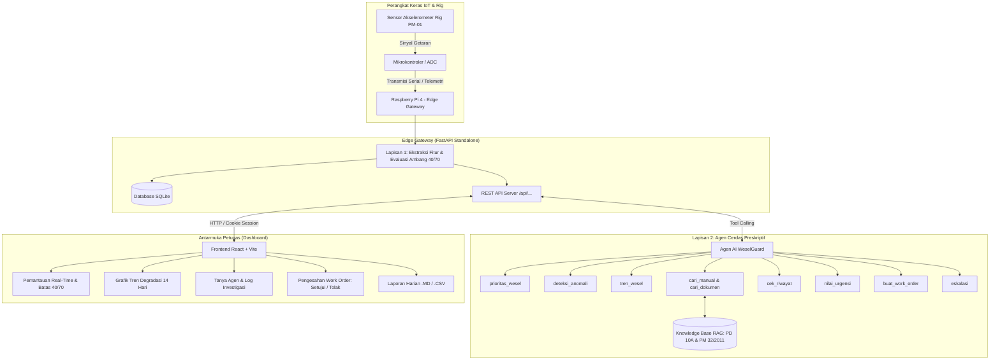

# 🚆 WeselGuard: AI Agent Preskriptif & Pemantauan IoT Wesel Sintelis Kereta Api

> Sistem pemantauan telemetri getaran berbasis IoT Edge dan Agen AI preskriptif untuk keandalan wesel persinyalan kereta api (*Sintelis*), mengacu pada regulasi KAI **PD 10A**, **PM 10/2011**, dan **PM 32/2011**.

---

## 📑 Daftar Isi
1. [Masalah dan Pengguna Sasaran](#1-masalah-dan-pengguna-sasaran)
2. [Prototype Sistem (Hardware IoT & Sensor)](#2-prototype-sistem-hardware-iot--sensor)
3. [Arsitektur Agen AI](#3-arsitektur-agen-ai)
4. [Dashboard Frontend & REST API](#4-dashboard-frontend--rest-api)
5. [Daftar Dependensi](#5-daftar-dependensi)
6. [Konfigurasi Contoh (Tanpa Data Rahasia)](#6-konfigurasi-contoh-tanpa-data-rahasia)
7. [Cara Instalasi dan Menjalankan Aplikasi](#7-cara-instalasi-dan-menjalankan-aplikasi)
8. [Keterbatasan Sistem](#8-keterbatasan-sistem)
9. [Pembagian Kontribusi Anggota Tim](#9-pembagian-kontribusi-anggota-tim)

---

## 1. Masalah dan Pengguna Sasaran

### 1.1 Latar Belakang Masalah
Wesel adalah peralatan jalan rel yang mengarahkan kereta api berpindah jalur. Kegagalan mekanik wesel (misalnya *poros penarik tidak sejajar*, *keausan bantalan pelat gelincir*, atau *penguncian tidak sempurna*) berdampak serius:

- **Risiko keselamatan berat:** berpotensi memicu anjlokan (*derailment*) yang mengancam penumpang dan awak kereta.
- **Keterlambatan masif (LAA/TKA):** kerusakan wesel di stasiun sibuk menimbulkan efek domino pada kelambatan lintas kereta api.
- **Kelemahan inspeksi konvensional:** pemeliharaan masih bersifat preventif-kalender atau korektif-reaktif, sehingga kerusakan yang berkembang di antara dua jadwal pemeriksaan sering tidak terdeteksi sebelum terjadi gangguan dinas.
- **Kesenjangan analisis regulasi:** teknisi lapangan membutuhkan waktu dan ketelitian tinggi untuk mencocokkan gejala sinyal dengan regulasi pemeliharaan jalan rel KAI (**PD 10A**) dan formulir kelaikan penggerak wesel (**PM 32/2011**).

### 1.2 Pengguna Sasaran (*User Personas & RBAC*)
Sistem menerapkan pembatasan hak akses berbasis peran (*Role-Based Access Control*):

| Peran | Wewenang |
|---|---|
| **Petugas Sintelis** (teknisi lapangan) | Memantau telemetri akselerometer secara real-time, menjalankan evaluasi bersama Agen AI, serta menyetujui/menolak draf *Work Order* (WO) perbaikan sebelum dieksekusi di lapangan. |
| **Pengelola** (*Knowledge Manager*) | Mengelola basis pengetahuan (unggah PDF/DOCX regulasi PD 10A, manual pabrikan, SOP), memverifikasi potongan teks (*chunks*), dan menguji pencarian semantik sebelum diaktifkan ke agen. |
| **Administrator** | Kendali penuh akun pengguna, sakelar operasional agen AI, dan audit jejak aktivitas (*audit logs*). |
| **Pengamat** (Auditor / Kepala Stasiun) | Akses baca saja: melihat grafik tren degradasi 14 hari, indikator kesehatan, dan mengunduh laporan harian stasiun (.MD / .CSV). |

---

## 2. Prototype Sistem (Hardware IoT & Sensor)

### 2.1 Rig Uji Coba Fisik (Node PM-01)
- **Sensor node:** modul akselerometer industri terpasang pada lidah penuntun rel dan kotak penggerak wesel pada rig uji coba fisik **PM-01**.
- **Sampling & sinyal:** sensor menangkap getaran selama siklus pembalikan lidah wesel (umumnya berdurasi 4,5 – 6,0 detik).
- **Ekstraksi fitur di edge:**

| Parameter | Fungsi | Acuan |
|---|---|---|
| **RMS** (Root Mean Square) | Intensitas beban mekanis getaran total | Normal < 2,5 m/s² |
| **Kurtosis spektral** | Ketajaman lonjakan impuls / impak keausan | Normal 2,8 – 3,2 (mendekati distribusi Gauss) |
| **Puncak frekuensi (Hz)** | Frekuensi dominan getaran saat motor berputar | – |
| **Durasi siklus pembalikan (detik)** | Waktu pembalikan lidah wesel | Maksimum PD 10A: ≤ 6,0 detik |

### 2.2 Deteksi Dua Lapis (*Two-Tier Detection*)
- **Lapisan 1 – Edge Anomaly Classifier:** berjalan real-time di Raspberry Pi. Membandingkan fitur sinyal terhadap ambang batas deterministik untuk menghasilkan skor kesehatan 0 – 100:
  - **70 – 100 (Normal / Hijau):** wesel beroperasi prima.
  - **40 – 69 (Waspada / Kuning):** gejala degradasi awal, perlu pemantauan tren.
  - **< 40 (Bahaya / Merah):** kondisi kritis; terdapat impak mekanis ekstrem atau potensi penguncian gagal.
- **Lapisan 2 – Agen AI Preskriptif:** bila terdeteksi kondisi waspada/bahaya, agen membaca data mentah, mencocokkan riwayat kerusakan, mengkaji regulasi PD 10A, dan menyusun draf langkah penanganan teknis.

---

## 3. Arsitektur Agen AI

### 3.1 Diagram Alur Kerja



### 3.2 Sembilan Alat Otonom (*Autonomous Tools*)

| No | Tool | Fungsi |
|:---:|---|---|
| 1 | `prioritas_wesel` | Mengurutkan wesel paling kritis (Bahaya → Tidak dikenal → Waspada → Normal). |
| 2 | `deteksi_anomali` | Menganalisis ketidakteraturan sinyal getaran (RMS & kurtosis) saat pembalikan lidah rel. |
| 3 | `tren_wesel` | Menghitung laju degradasi poin per hari dan memproyeksikan hari menuju batas Kelas B. |
| 4 | `cari_manual` | Menemukan bab instruksi perbaikan pada manual pabrikan penggerak wesel. |
| 5 | `cari_dokumen` | Pencarian semantik potongan dokumen pada basis pengetahuan regulasi KAI PD 10A. |
| 6 | `cek_riwayat` | Memeriksa log perbaikan terdahulu untuk mengetahui apakah komponen pernah diperbaiki. |
| 7 | `nilai_urgensi` | Mengklasifikasikan kelas perbaikan (Kelas A / B / C / Eskalasi Darurat). |
| 8 | `buat_work_order` | Menyusun draf perintah kerja teknis lengkap dengan rujukan pasal dan tindakan mitigasi. |
| 9 | `eskalasi` | Mengirim peringatan darurat instan saat anomali membahayakan keselamatan dinas. |

### 3.3 Prinsip *Human-in-the-Loop*
Sistem **tidak pernah** mengeksekusi tindakan ke wesel tanpa verifikasi manusia. Seluruh draf usulan Agen AI masuk ke **Antrean Keputusan (Work Order)**. Petugas berwenang wajib menyetujui (*Approve*) atau menolak (*Reject*) dengan **catatan wajib** pada penolakan.

---

## 4. Dashboard Frontend & REST API

### 4.1 Fitur Dashboard
Antarmuka memakai navigasi sidebar berbasis halaman (*page-view*), tanpa modal mengambang:

- **Beranda (Pemantauan Wesel):** kartu ringkasan status agregat, tabel pemantauan dengan polling 5 detik, progress bar dan batas 40 & 70, indikator sensor senyap (> 120 menit), serta panel prioritas cerdas.
- **Detail Wesel & Tren 14 Hari:** metrik fisik sinyal, grafik garis SVG tren degradasi dengan garis ambang putus-putus 70 & 40, estimasi laju degradasi harian, dan tombol evaluasi agen inline.
- **Tanya Agen & Riwayat Percakapan:** obrolan interaktif dengan dua tab (*Obrolan* dan *Sesi Analisis*), cuplikan pemanggilan tool agen, peringatan memori non-permanen, dan saran pertanyaan cepat.
- **Antrean Keputusan Work Order:** tab *Menunggu Keputusan* dan *Riwayat Keputusan*, label urgensi berwarna (Kelas A: merah, B: kuning, C: hijau, Eskalasi: ungu), modal keputusan, dan stempel verifikator.
- **Laporan Harian Stasiun:** kalender tanggal pemantauan, tabel rekapitulasi, dan ekspor **Markdown (.MD)** serta **Spreadsheet (.CSV)**.
- **Basis Dokumen Pengetahuan:** filter dokumen, inspeksi potongan teks (*Chunk Inspector*), pengujian pencarian semantik pra-aktivasi, dan form unggah PDF/DOCX.
- **Manajemen Pengguna & Audit:** manajemen akun dinas, reset sandi, status aktif/nonaktif, pencegahan *lockout* akun admin sendiri, dan linimasa 50 jejak aktivitas audit.
- **Profil Pengguna & Keamanan:** deskripsi wewenang peran dan formulir penggantian kata sandi mandiri.

### 4.2 Endpoint REST API Backend

| Metode | Endpoint | Fungsi | Hak Akses |
|---|---|---|---|
| `POST` | `/api/login` | Autentikasi sesi (username & kata sandi) | Semua |
| `GET` | `/api/saya` | Profil dan peran sesi aktif | Terautentikasi |
| `POST` | `/api/logout` | Menghapus sesi masuk | Terautentikasi |
| `GET` | `/api/koneksi` | Status koneksi online/offline & latensi (ms) | Terautentikasi |
| `GET` | `/api/wesel` | Telemetri getaran & status seluruh wesel | Terautentikasi |
| `GET` | `/api/wesel/{id}/tren` | Tren harian 14 hari & laju degradasi | Terautentikasi |
| `POST` | `/api/wesel/{id}/analisis` | Menjalankan evaluasi agen pada wesel | Admin, Petugas |
| `POST` | `/api/chat` | Memulai atau melanjutkan obrolan dengan agen | Terautentikasi |
| `GET` | `/api/work-orders` | Daftar draf dan riwayat keputusan work order | Terautentikasi |
| `POST` | `/api/work-orders/{id}/setujui` | Menyetujui usulan perbaikan | Admin, Petugas |
| `POST` | `/api/work-orders/{id}/tolak` | Menolak usulan perbaikan (catatan wajib) | Admin, Petugas |
| `GET` | `/api/dokumen` | Daftar dokumen pengetahuan RAG | Terautentikasi |
| `POST` | `/api/dokumen` | Unggah dokumen baru (multipart/form-data) | Admin, Pengelola |
| `GET` | `/api/pengguna` | Daftar akun pengguna dinas | Admin |
| `GET` | `/api/pengguna/audit` | Linimasa jejak aktivitas sistem | Admin |

---

## 5. Daftar Dependensi

### 5.1 Backend (Python 3.10+)
| Paket | Kegunaan |
|---|---|
| `fastapi >= 0.110.0` | Framework API asinkron berkinerja tinggi |
| `uvicorn[standard] >= 0.28.0` | Server ASGI untuk menjalankan aplikasi secara standalone |
| `pydantic >= 2.6.0` | Validasi skema data permintaan dan tanggapan |
| `google-genai >= 0.1.0` | SDK integrasi model penalaran Agen AI |
| `python-multipart` | Penanganan unggah berkas dokumen regulasi |
| `numpy`, `scipy` | Komputasi ekstraksi fitur getaran (RMS, kurtosis spektral) |
| `sqlite3` | Basis data relasional ringan untuk penyimpanan lokal di edge device (bawaan Python, tidak perlu diinstal terpisah) |

### 5.2 Frontend (Node.js 18+)
| Paket | Kegunaan |
|---|---|
| `react ^18.3.1` | Pustaka antarmuka pengguna berbasis komponen |
| `react-dom ^18.3.1` | Renderer DOM untuk aplikasi web |
| `vite ^5.4.11` | Build tool dan dev server dengan HMR |
| `@vitejs/plugin-react` | Plugin React untuk Vite |

---

## 6. Konfigurasi Contoh (Tanpa Data Rahasia)

> ⚠️ **Jangan pernah** meng-commit berkas `.env` asli atau API key ke repositori. Gunakan `.env.example` sebagai templat dan tambahkan `.env` ke `.gitignore`.

### 6.1 Environment Backend (`.env.example`)
Salin menjadi `/home/pi/hackathon/hackathon/.env`, lalu isi dengan nilai milik Anda sendiri:

```ini
# Konfigurasi server
HOST=0.0.0.0
PORT=8000
DEBUG=False

# Kunci API model AI (isi dengan API key milik Anda)
GEMINI_API_KEY=ISI_DENGAN_API_KEY_ANDA

# Konfigurasi keamanan sesi (gunakan string acak panjang, minimal 32 karakter)
SECRET_KEY=ISI_DENGAN_STRING_ACAK_PANJANG
SESSION_EXPIRE_HOURS=12

# Database & folder penyimpanan
DATABASE_PATH=weselguard.db
UPLOAD_DIR=storage/dokumen/
```

### 6.2 Unit Systemd (`/etc/systemd/system/wesel-agent.service`)

```ini
[Unit]
Description=Agent Wesel
After=network.target

[Service]
Type=simple
User=pi
Group=pi
WorkingDirectory=/home/pi/hackathon/hackathon
EnvironmentFile=-/home/pi/hackathon/hackathon/.env
EnvironmentFile=-/home/pi/hackathon/.env

ExecStart=/home/pi/hackathon/.venv/bin/uvicorn server:app --host 0.0.0.0 --port 8000 --proxy-headers

Restart=always
RestartSec=3

NoNewPrivileges=true
PrivateTmp=true

[Install]
WantedBy=multi-user.target
```

### 6.3 Proxy Vite (`vite.config.js`)

```javascript
import { defineConfig } from "vite";
import react from "@vitejs/plugin-react";

export default defineConfig({
  plugins: [react()],
  server: {
    proxy: {
      "/api": {
        target: process.env.API_TARGET || "http://127.0.0.1:8000",
        changeOrigin: true,
      },
    },
  },
});
```

---

## 7. Cara Instalasi dan Menjalankan Aplikasi

### 7.1 Setup Backend di Raspberry Pi

1. **Siapkan virtual environment dan pasang dependensi:**
   ```bash
   cd ~/hackathon
   python3 -m venv .venv
   source .venv/bin/activate
   pip install --upgrade pip
   pip install -r hackathon/requirements.txt
   ```

2. **Buat berkas `.env`** di `~/hackathon/hackathon/.env` berdasarkan contoh pada [bagian 6.1](#61-environment-backend-envexample).

3. **Daftarkan dan aktifkan service systemd** (isi unit sesuai [bagian 6.2](#62-unit-systemd-etcsystemdsystemwesel-agentservice)):
   ```bash
   sudo nano /etc/systemd/system/wesel-agent.service   # tempel isi unit
   sudo systemctl daemon-reload
   sudo systemctl enable --now wesel-agent
   sudo systemctl status wesel-agent
   ```

   Untuk uji coba tanpa systemd, backend dapat dijalankan langsung:
   ```bash
   cd ~/hackathon/hackathon
   ../.venv/bin/uvicorn server:app --host 0.0.0.0 --port 8000
   ```

### 7.2 Setup Frontend Dashboard

1. **Pasang dependensi:**
   ```bash
   cd ~/hackathon/frontend
   npm install
   ```
2. **Jalankan mode pengembangan:**
   ```bash
   npm run dev
   ```
   Buka `http://localhost:5173` di peramban. Permintaan `/api` otomatis diteruskan ke backend melalui proxy Vite.
3. **Build untuk rilis produksi:**
   ```bash
   npm run build
   ```

---

## 8. Keterbatasan Sistem

1. **Ketergantungan akses model AI eksternal:** analisis penalaran kontekstual membutuhkan koneksi ke API model AI. Saat koneksi offline, sistem beralih otomatis ke Lapisan 1 (peringatan berbasis aturan di edge).
2. **Lingkungan sensor yang bising:** akselerometer pada lidah rel juga dapat menangkap getaran dari luar (misalnya kereta melintas). Algoritma meredamnya dengan membatasi analisis pada jendela waktu saat motor penggerak aktif, tetapi hasil tetap dapat dipengaruhi kondisi lapangan.
3. **Penyimpanan sesi sementara:** pada mode non-permanen, riwayat chat agen disimpan di memori RAM server dan hilang saat service dimulai ulang.
4. **Skala prototype:** pengujian fisik dilakukan pada satu rig (node PM-01) dan simulasi telemetri stasiun, sehingga belum divalidasi pada banyak wesel di lapangan sesungguhnya.

---

## 9. Pembagian Kontribusi Anggota Tim

| No | Anggota | Peran Utama | Kontribusi Teknis |
|:---:|---|---|---|
| **1** | **Farhan** | IoT Hardware, Data Analyst & Frontend | • Perancangan dan kalibrasi sensor akselerometer pada rig uji coba (Node PM-01).<br>• Analisis sinyal mekanik, kurva getaran, dan ekstraksi fitur fisik (RMS, kurtosis, frekuensi dominan).<br>• Kolaborasi pengembangan dashboard monitoring web (Frontend). |
| **2** | **Amar** | AI Engineer, DevOps & Frontend | • Perancangan arsitektur Agen AI, implementasi 9 tool otonom, dan sistem RAG dokumen regulasi KAI PD 10A.<br>• DevOps: daemon systemd standalone, proxy gateway, dan pengelolaan environment Raspberry Pi.<br>• Kolaborasi pengembangan dashboard monitoring web (Frontend). |
